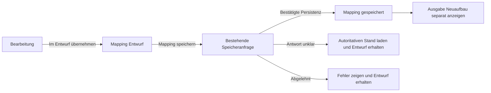

# Bootstrap 6 und die Modernisierung der Threadfin Oberfläche

Stand: 20. Oktober 2026. Konzept zur Diskussion, noch keine Implementierung.

Branch: `bootstrap-6`. Ausgangspunkt: Threadfin v3.4.0, Commit `0d9c81151e995ee89cb1baabd8580cc3d7e4369e`.

## Empfehlung

Threadfin sollte Bootstrap 6 als Grundlage für ein zusammenhängendes Designsystem und eine Modernisierung der wichtigsten Arbeitsabläufe einsetzen. Erscheinungsbild und Bedienung erhalten das gleiche Gewicht. Der erste vollständige Anwendungsfall ist Mapping: durchsuchbare EPG-Zuordnung, sichtbare Filter, Bearbeitung neben der Kanalliste und eindeutig erkennbare Entwürfe.

Die Umstellung beginnt mit der Modulinitialisierung, der CSS-Kaskade und den gemeinsamen Bedienelementen. Anschließend folgen die Arbeitsbereiche. Die bestehende Informationsarchitektur und die bewährten Daten- und Speicherverträge bleiben erhalten. Ein zusätzliches Frontend-Framework ist dafür nicht erforderlich.

Als Ausgangsversion wird exakt `6.0.0-alpha.1` verwendet. Das npm-Tag `next` zeigt beim Abruf auf diese Version; `latest` zeigt weiterhin auf `5.3.8`. Die Alpha ist für Entwicklung und Qualifizierung geeignet. Ihre Veröffentlichung ist noch kein Nachweis, dass sie mit Threadfin oder allen eingesetzten Endgeräten funktioniert. Vor einer produktiven Umstellung stehen die unten beschriebenen Browser-, Funktions- und Performanceprüfungen. [Ankündigung][s1] · [npm-Versionen][s2]

## Ziele und Grenzen

Die Nutzer sollen Quellen einrichten, Zuordnungsprobleme erkennen, viele Kanäle bearbeiten und ihre Client-Ausgaben prüfen können, ohne den Arbeitskontext ständig zu verlieren. Der sichtbare Fortschritt soll sich an diesen Aufgaben messen lassen:

- Eine EPG-Zuordnung lässt sich anhand von Name und ID durchsuchen und eindeutig auswählen.
- Aktive Such- und Filterbedingungen sind sichtbar und einzeln entfernbar.
- Der Kanal bleibt während der Bearbeitung erkennbar; Auswahl, Suchzustand und Scrollposition bleiben erhalten.
- Entwurf, Speicherung und Ausgabe-Neuaufbau sind optisch und sprachlich unterscheidbar.
- Tablet-Bedienung bietet dieselben wesentlichen Aktionen wie der Desktop, mit erreichbaren Bedienelementen und brauchbarer Bildschirmtastatur.
- Navigation, Formulare, Tabellen, Dialoge und Zustandsanzeigen wirken wie Teile desselben Produkts, einschließlich Hell- und Dunkeldarstellung.

Die bekannten Ziele Overview, Playlist, XMLTV, Filter, Mapping, Connections, Activity, Users, Settings und Log bleiben auffindbar. PMS und XEPG werden weiterhin fachlich korrekt unterschieden. Bestehende Auswahl- und Speicherregeln, Berechtigungen, Client-URLs und Kanalgrenzen werden übernommen.

Eine neue Backend-API, automatische EPG-Zuordnung, Client-Fernkonfiguration, neue Monitoring-Dienste und eine generelle Neuentwicklung der Anwendung gehören nicht zu diesem Vorhaben. Ebenso wenig werden Datepicker, OTP-Eingaben oder dekorative Komponenten allein wegen ihrer Verfügbarkeit eingebaut.

## Geprüfter Stand von Bootstrap 6

Die Recherche umfasst die Ankündigung, den Migrationsleitfaden, die jeweiligen Komponentenseiten, npm-Metadaten und ausgelieferte CSS-/JS-Dateien. Für kritische Details wurden zusätzlich die Quellen des Tags `v6.0.0-alpha.1` geprüft. Die Aussagen über den bestehenden Threadfin-Code beziehen sich auf den oben genannten Ausgangscommit.

### Welche Neuerungen einen Unterschied machen

| Funktion in Bootstrap 6 | Bedeutung für Threadfin | Einordnung |
| --- | --- | --- |
| Umfassende CSS-Tokens, semantische `.theme-*`-Klassen und CSS-Layer | Ein gemeinsames Farbsystem, konsistente Oberflächen, Fokuszustände und Komponentenvarianten | Grundlage, höchste Priorität |
| Native Dialog- und Drawer-Komponenten auf `<dialog>` | Einheitliche Bearbeitung und Bestätigung mit browserseitiger Modalität und Fokusführung | Grundlage und Mapping-Pilot |
| Neue Combobox mit Suche, Auswahl und Tastaturbedienung | EPG-Kanäle und Backup-Ziele anhand von ID und Namen auswählen | Höchster unmittelbarer Nutzen im Mapping |
| Chips und Chip-Eingaben | Aktive Filter sichtbar machen und gezielt entfernen | Mapping und Filter; keine Änderung der Filtergrammatik |
| Neues `.form-field` mit Label, Hilfe und Rückmeldung | Verständlichere Quellen-, Mapping- und Settings-Formulare | Gemeinsames Formulardesign |
| Container Queries und gestapelte Tabellen | Darstellung am verfügbaren Arbeitsbereich ausrichten; kurze Listen auf kleinen Flächen lesbar halten | Quellen, Activity und ausgewählte Mapping-Ansichten |
| Native Accordion-Struktur mit `<details>` und `<summary>` | Erweiterte Einstellungen zugänglich zusammenfassen | Bestehende Disclosure-Ansätze vereinheitlichen |
| Neues Menu mit Floating UI | Kontextaktionen ohne breite Aktionsspalten | Sekundäre Aktionen; Hauptaktionen bleiben sichtbar |
| NavOverflow | Settings-Navigation bei schmalen Flächen oder langen Übersetzungen erreichbar halten | Nachrangig, nach Prüfung der Tab-Integration |
| ESM-only und mitgelieferte TypeScript-Typen | Explizite Abhängigkeiten, gezielte Komponentenimporte und verlässliche Initialisierung | Technische Voraussetzung |

CSS-Variablen, Dark Mode und ESM gab es bereits in Bootstrap 5. Der Gewinn liegt bei v6 in der konsequenteren Tokenisierung, den neuen Komponenten und dem verbindlichen Modulmodell. Container Queries sind eine Browserfunktion; Bootstrap liefert dafür konkrete Komponenten und Hilfen. Diese Unterscheidung verhindert, dass vorhandene Fähigkeiten als neue Produktfunktionen verkauft werden. [Migration][s3] · [Tokens][s4] · [Theme][s5] · [Farbmodi][s6]

### Browser und Alpha-Reife

Die dokumentierten Mindestversionen sind Chrome/Edge 130, Firefox 132 und Safari 18 einschließlich iOS. Bootstrap 6 liefert unterhalb dieser Grenze keine Polyfills oder ältere CSS-Fallbacks. Vor der Entscheidung für einen produktiven Standard muss deshalb insbesondere die Safari-/iPadOS-Version der tatsächlich genutzten Geräte erfasst werden. Eine kleinere emulierte Bildschirmgröße ersetzt diesen Test nicht. [Browser-Unterstützung][s7]

Animationen sind eine Ergänzung. Disclosure, Navigation, Bearbeitung und Speicherung müssen auch bei reduzierter Bewegung und ohne neuere optionale Animationsfähigkeiten bedienbar bleiben.

Die Alpha wird exakt gepinnt und bewusst aktualisiert. Ein neues Alpha-Release wird gegen dieselben Funktionsproben verglichen. Bis die Qualifizierung gelingt, bleibt v3.4.0 der nutzbare bisherige Release; eine zweite Bootstrap-Laufzeit oder Browser-Fallback-Schicht innerhalb derselben Oberfläche ist nicht vorgesehen.

## Ausgangslage in Threadfin

Threadfin hat bereits eine fachlich gegliederte Sidebar, einen Signalpfad in Overview, explizite Mapping-Entwürfe und eine Absicherung gegen das Verlassen ungespeicherter Zuordnungen. Diese Fähigkeiten werden weiterentwickelt. Die Modernisierung startet nicht bei einer ungegliederten Altoberfläche.

| Stelle im Repository | Aktueller Befund | Konsequenz für die Umstellung |
| --- | --- | --- |
| `html/index.html`, `configuration.html`, `login.html`, `create-first-user.html` | Bootstrap 5.3.8 per CDN; App und Setup laden das klassische JS-Bundle | Alle vier Dokumente erhalten dieselbe CSS-Grundlage; JS nur dort, wo benötigt |
| `ts/base_ts.ts` | Globales `bootstrap`, zwei `Modal`-Instanzen und Tooltip-Verwendung bei der Initialisierung | Explizite Imports und definierter Startablauf; Modal-Markup und Aufrufer gemeinsam migrieren |
| `ts/navigation_ts.ts` | Mobile Navigation nutzt `Collapse`; Sidebar besitzt eigene Zustände und History-Anbindung | Mobile Navigation über Drawer; Sidebar-Verhalten und Routen erhalten |
| `ts/sources_ts.ts`, `filter_ts.ts`, `users_page_ts.ts` | Wiederverwendete Popups, fachliche Fehlerzustände und teilweise Modal-Ereignisse | Lebenszyklen einschließlich Fokus und Wiederöffnung mit Dialog migrieren |
| `ts/mapping_ts.ts` | Eigene Overlay- und Tastatursteuerung; separate Entwurfs- und Speicherzustände | Native Dialog-/Drawer-Bedienung nutzen, fachlichen Zustand erhalten |
| `ts/mapping_state_ts.ts`, `app_state_ts.ts` | Bereits getrennte Zustands- und Ableitungslogik | Diese Logik weiterverwenden statt einen neuen universellen Store einzuführen |
| `html/css/base.css`, `screen.css`, `app-shell.css` | Rund 3.300 CSS-Zeilen; globale Elementregeln, feste dunkle Farben, eigenes Formular- und Tabellenstyling | Globale Regeln zurückbauen und gezielt in die Layer-Struktur überführen |
| `ts/tsconfig.json` | `module: commonjs`, klassische Skripte mit gemeinsamem globalen Namensraum | Nicht allein den Modulschalter ändern; Abhängigkeiten und Einstiegspunkte explizit machen |
| `src/webserver.go`, `src/web_security.go` | JS-MIME-Typ vorhanden; Assets werden eingebettet und sprachabhängig ausgeliefert; CSP erlaubt derzeit CDN-Quellen | ESM ist serverseitig grundsätzlich darstellbar; Pfade, Sprachplatzhalter und CSP bleiben Abnahmepunkte |
| `src/ui_*_test.go`, `src/html_build_test.go` | Umfangreiche Verhaltens- und Asset-Paritätstests; viele Node-VM-Fixtures erwarten globale Skripte | Fixtures an Modulgrenzen anpassen und fachliche Assertions erhalten |

Die stärksten Bruchstellen sind damit Initialisierung, Dialoge und CSS-Kaskade. Ein flächiges Ersetzen responsiver Klassennamen wäre für diese Codebasis keine ausreichende Migration.

Als fachliche Referenzen dienen der bestehende [UI-Entwurf](2026-08-26-ui-information-architecture-design.md), die [bisherige Abnahme](../reports/2026-08-26-ui-acceptance.md) und die [Nutzeranleitung](../../user-guide.md). Die damalige 5.000-Zeilen-Prüfung war eine DOM-Charakterisierung; sie ersetzt keine aktuelle Browsermessung für Bootstrap 6.

## Betrachtete Wege

| Weg | Nutzen | Aufwand und Schwäche | Bewertung |
| --- | --- | --- | --- |
| Versionswechsel und Anpassung der bisherigen Optik | Schneller technischer Einstieg | Bestehende CSS-Konflikte und Arbeitsabläufe bleiben; neue Komponenten bringen wenig Produktnutzen | Als isolierter Prototyp brauchbar, als Ziel unzureichend |
| Gemeinsames Bootstrap-6-Designsystem mit schrittweiser Modernisierung der Arbeitsbereiche | Deutlich neuer visueller Auftritt und konkrete Verbesserungen bei erhaltenen Fachverträgen | Modulinitialisierung, CSS und Tests müssen gezielt umgestellt werden | Empfohlen |
| Neues Frontend mit zusätzlichem Anwendungsframework | Weitreichende neue Architektur möglich | Erneute Lösung bereits vorhandener Zustands-, Routing- und Formularfragen ohne nachgewiesene Notwendigkeit | Nicht erforderlich |

## Das sichtbare Zielbild

### Gemeinsame Gestaltung

Die Oberfläche erhält eine ruhige, klar gegliederte Arbeitsfläche mit einer eigenständigen Threadfin-Farbwelt. Cyan bleibt als wiedererkennbarer Primärakzent erhalten. Flächen, Text, Fokus und Zustände werden semantisch statt seitenweise definiert.

| Gestaltungsbereich | Vorgesehene Umsetzung | Sichtbarer Effekt |
| --- | --- | --- |
| Flächen | Bootstrap-Hintergrundskala und gemeinsame Threadfin-Tokens für Seite, Navigation, Panel und Eingabefläche | Trennung durch Hierarchie und Abstand statt durch viele Rahmen |
| Text | Systemschrift, normale Laufweite, klare Überschriften und kompakte Metadaten | Lange Sendernamen, URLs und Einstellungen sind leichter lesbar |
| Akzent | Cyan-Primärtheme mit zum Farbmodus passenden Vordergründen und Kontrasten | Wiedererkennbarkeit ohne überall leuchtende Flächen |
| Zustand | Semantische Themes für bereit, Hinweis, Warnung, Fehler und ausstehende Änderung | Status ist konsistent und zusätzlich als Text oder Symbol erkennbar |
| Interaktion | Gemeinsame Radien, Abstände, Fokus-Tokens und Varianten für primäre, sekundäre und gefährliche Aktionen | Buttons und Felder wirken über alle Bereiche hinweg zusammengehörig |
| Farbmodus | Systempräferenz mit lokaler Wahl Hell/Dunkel/System über `data-bs-theme` | Nutzbarkeit in hellen und dunklen Umgebungen ohne doppelte Stylesheets |
| Dichte | Lesbare Tabellen auf dem Desktop; größere Trefferflächen bei Touch-Bedienung | Viele Kanäle bleiben vergleichbar, Tablet-Aktionen bleiben erreichbar |

Die Token-Ebene verwendet die vorhandenen Bootstrap-Variablen und wenige semantische `--tf-*`-Ergänzungen. Es entsteht kein eigener Theme-Generator. Die bestehenden festen Weiß-auf-Dunkel-Regeln und globalen `outline: none`-Regeln dürfen das neue System nicht weiter übersteuern.

Die Sidebar behält ihre beschriftete und schmale Darstellung. Lange Menüs dürfen nicht durch verteilende Flex-Abstände aus dem sichtbaren Bereich gedrückt werden. Das ist Bestandteil der Tablet-Abnahme, einschließlich User guide und Logout.

### Mapping als vollständiger Pilot

Mapping eignet sich als erster Arbeitsbereich, weil hier Design, Tabellen, Filter, Auswahl, Formulare, Dialoge und Speichersemantik gemeinsam sichtbar werden.

```text
Sidebar    Mapping                 3 Änderungen im Entwurf   [Mapping speichern]
           [Alle] [Aktiv] [Prüfen]  [Suche nach Kanal, ID oder Quelle ........]
           Filter: [Playlist A ×] [EPG fehlt ×]               [Zurücksetzen]

           12 ausgewählt    [Bearbeiten] [Dummy EPG zuweisen] [Weitere ▾]

           Kanal   Name          Quelle       EPG             Zustand
           101     Beispiel HD   Playlist A   Beispiel HD     Bereit
           102     Regional HD   Playlist A   Keine Zuordnung Prüfen
           ...

           Breite Ansicht: rechts der Editor mit Kanalname, EPG-Suche,
           Aktivierung, erweiterten Feldern und [Im Entwurf übernehmen].
           Schmale Ansicht: derselbe Editor als Drawer bzw. hohe Vollansicht.
```

Die Skizze beschreibt die Anordnung, keine bereits implementierte Oberfläche.

**EPG-Auswahl:** Die neue Combobox sucht nach lesbarem Namen und stabiler Kanal-ID. Die Auswahl liefert weiterhin die bestehenden XMLTV-/Dummy-Werte. Bootstrap übernimmt Suche, Optionsnavigation und Auswahlbedienung; Threadfin validiert die fachliche Auswahl und schreibt sie in den vorhandenen Entwurf. Ein eigenes Autocomplete wird nicht gebaut. Bei Multi-Auswahl wird nicht blind der kommaseparierte Hidden-Input-Wert in das bestehende Datenmodell übernommen. Für die erste EPG-Zuordnung genügt Single-Select. [Combobox][s8]

**Filter:** Chips zeigen bereits aktive Filter aus dem vorhandenen Query-Zustand. Entfernen ändert diesen Zustand über die vorhandenen Filterfunktionen. Freie Chip-Texte werden weder zu neuen Filterregeln noch zu einer neuen Abfragesprache. Die Bereichswechsel Alle/Aktiv/Prüfen und die Bedeutung der Auswahl bleiben erhalten. [Chips][s9]

**Bearbeitung:** Ein gemeinsames Formular nutzt den nativen responsiven Drawer, soweit der Alpha-Prototyp das benötigte Verhalten bestätigt. Für die breite, eingebettete Seitenansicht ist der Bootstrap-Breakpoint `2xl` mit 1536 px der erste Prüfwert; darunter wird die Bearbeitung modal geöffnet. Die endgültige Grenze folgt aus der nutzbaren Tabellenbreite. Drawer-Responsive-Klassen reagieren auf den Viewport; interne Formular- und Panel-Layouts dürfen zusätzlich Container Queries verwenden. Ein ausgefahrener Seitenbereich darf die Tabelle nicht zu unbrauchbaren schmalen Spalten zusammendrücken. [Drawer][s10]

**Große Auswahllisten:** Bootstrap ist keine Datenbankabfrage oder virtuelle Datentabelle. EPG-Listen und 5.000 importierte Kanäle werden im Prototyp realistisch vermessen. Pagination oder Virtualisierung wird erst bei einem nachgewiesenen Problem entworfen. Die bestehende Kanalgrenze für Ausgaben wird dabei nicht verändert.

**Speicherzustand:** Der Editor übernimmt Änderungen zunächst in den Entwurf. Erst Mapping speichern fordert die bestehende Backend-Mutation an. Das Schließen eines Drawers oder das Ende einer Animation gilt nicht als gespeicherter Zustand.



Ausgabe aufgebaut, Aufbau angefordert und Aufbau fehlgeschlagen bleiben unterschiedliche Rückmeldungen. Bei unklarem Transportergebnis bleibt die bestehende Abklärung erhalten; ein zweiter Speicheraufruf darf keine vermeintlich erfolgreiche Animation auslösen.

### Weitere Arbeitsbereiche

| Bereich | Vorgesehene Modernisierung | Bestehender Vertrag |
| --- | --- | --- |
| Overview | Gemeinsame Statuskarten und ein klarer nächster Arbeitsschritt entlang des Signalpfads | Nur Zustand behaupten, den Threadfin tatsächlich kennt |
| Playlist und XMLTV | Prägnante Quellenlisten; Aktualisieren und Fehler direkt an der Quelle; Formularfelder mit Hilfe und Rückmeldung | Vorhandene CRUD-/Update-Aufrufe und Quellenzustände |
| Filter | Verständliche Regelzusammenfassung, sichtbarer Geltungsbereich und einheitliche Eingaben | Bestehende Group-/Custom-Filtersemantik |
| Connections | Lesbare Client-Endpunkte mit verlässlicher Kopierbestätigung und klaren PMS-/XEPG-Hinweisen | Keine Behauptung über den Erfolg im externen Client |
| Activity und Log | Kompakte Statusdarstellung; erkennbare Filter; lange Inhalte in klar begrenzten Flächen | Vorhandene Live-Daten und Log-Schweregrade, keine neue Historisierung |
| Settings | Einheitliche `.form-field`-Struktur; erweiterte Felder in nativen Disclosures; gegebenenfalls NavOverflow für die Bereichsnavigation | Bestehende partielle Settings-Saves und Datentypen |
| Login und erster Benutzer | Gleiche Typografie, Farbmodi, Feld- und Fehlerdarstellung wie die App | Bestehende Browser-Authentifizierung und Einrichtung |
| Setup | Überschaubare Schritte, hilfreiche Feldtexte und stets erreichbare Hauptaktion | Bestehender Wizard und PMS-/XEPG-Abzweig |

Kurze Quellen- und Activity-Tabellen können die neuen gestapelten Tabellen nutzen. Bootstrap benötigt dafür den `.table-responsive`-Container und `data-cell` an den Zellen. Umfangreiche Mapping-Tabellen werden nicht pauschal in achtzeilige Karten pro Sender verwandelt; Kanal, Name, EPG und Zustand bleiben priorisiert, Details wandern in den Editor. [Tabellen][s11] · [Field][s12] · [Accordion][s13] · [NavOverflow][s14]

Menüs bündeln sekundäre Aktionen. Bearbeiten, Mapping speichern und das Beheben eines Problems dürfen dadurch nicht erst auffindbar werden. Fehler und Entwurfszustände bleiben dauerhaft am betroffenen Bereich sichtbar; Toasts sind ergänzende Bestätigungen. Lange Arbeiten bekommen eine ehrliche laufende oder angeforderte Anzeige statt erfundener Prozentwerte. [Menu][s15]

## Technisches Migrationskonzept

### Explizite Module und kontrollierte Initialisierung

Bootstrap 6 liefert keine klassische UMD-Laufzeit und kein `window.bootstrap`. Die exportierten Komponenten der geprüften Alpha enthalten unter anderem `Dialog`, `Drawer`, `Combobox`, `Chips`, `Menu`, `NavOverflow` und `Tooltip`. Deshalb genügt `type="module"` am bisherigen CDN-Skript für Threadfin nicht: `base_ts.ts` würde weiterhin während seiner klassischen Ausführung auf ein noch nicht vorhandenes Global zugreifen. [JavaScript][s16]

Vorgesehen sind explizite ESM-Einstiegspunkte für App, Setup und Authentifizierungsseiten. Sie initialisieren ihre eigenen DOM-Elemente nach den Imports und starten anschließend die benötigten Controller. Gemeinsamer Zustand erhält klare Modulbesitzer; die bestehenden fachlichen Zustandsfunktionen werden weiterverwendet. Es gibt kein nachgebildetes `window.bootstrap` und keine parallelen Alt-/Neu-Komponenten für dasselbe Element.

Ein kleiner Build mit esbuild ist der vorgeschlagene Weg, Bare Imports aufzulösen, nur benötigte Bootstrap-Komponenten einzubinden und auslieferbare lokale Assets zu erzeugen. Der konkrete Nutzen ist die ESM-Integration samt kleinerem JS-Anteil; ein zusätzlicher SPA-Unterbau entsteht nicht. Bootstrap-Komponenten werden über dokumentierte Einzelimporte eingebunden. Der erste Prototyp muss bestätigen, dass keine ungenutzten Kalender-Abhängigkeiten über den Importgraphen enthalten bleiben.

TypeScript-Prüfung und Asset-Erzeugung bleiben getrennte, reproduzierbare Schritte. Der vorhandene Aufruf `tsc -p ./ts/tsconfig.json` bleibt als dokumentierter Prüfschritt erhalten; die geänderte Compiler-Konfiguration und der zusätzliche Build-Schritt werden gemeinsam in README und CI festgelegt. Ein Lockfile pinnt Bootstrap, Floating UI und den Build. Sass und PostCSS werden erst ergänzt, wenn tatsächlich eigene Sass-Ausgaben benötigt werden; für die erste Token-Anpassung genügt das ausgelieferte CSS.

### CSS-Kaskade und konkrete Bruchstellen

Die geprüfte Alpha verwendet diese Reihenfolge:

```css
@layer colors, config, root, reboot, layout, content, forms, components,
       custom, helpers, utilities;
```

Threadfin-Komponenten und Anpassungen werden in den vorgesehenen `custom`-Layer eingeordnet. Die bisher globalen Elementregeln werden pro umgestelltem Bereich entfernt oder begrenzt. Nicht geschichtetes Alt-CSS steht bei normalen Deklarationen über den geschichteten Bootstrap-Regeln, unabhängig davon, welche Datei zuerst geladen wird. Ein reines Umordnen der Stylesheets löst das Problem daher nicht. Zusätzliche `!important`-Regeln sind kein Migrationsverfahren. [Gepinnte Layer-Quelle][s17]

| Bisher | Bootstrap 6 und erforderliche Anpassung |
| --- | --- |
| `bootstrap.Modal`, `.modal-*`, `shown.bs.modal` / `hidden.bs.modal` | `Dialog`, native `<dialog>`-Struktur, `.dialog-*` und entsprechende Dialog-Ereignisse |
| Eigene Mapping-Overlays mit Fokusfang | Fachliche Entwurfsabsicherung behalten; Modalität, Fokusfang und Backdrop an Dialog/Drawer delegieren |
| Mobile `Collapse`-Navigation | Native Drawer-Navigation; Schließen, Escape und Fokus zum Auslöser prüfen |
| Responsive Infixe wie `navbar-expand-lg` | Präfixnotation wie `lg:navbar-expand`; bestehende Klassen je nach tatsächlicher Verwendung migrieren |
| Alte Farb- und Variantenklassen | Intention auf neue semantische Themes und Varianten abbilden; keine pauschale Textersetzung |
| Globale dunkle Eingabe- und Tabellenregeln | `.form-field`, native Controls, Theme-Tokens und gemeinsame Tabellenstile |
| `commonjs` und implizite globale Querverweise | Explizite Imports/Exports und definierte Einstiegspunkte |

`lg` beginnt jetzt bei 1024 statt 992 px, `xl` bei 1280 statt 1200 px und `2xl` bei 1536 statt bisher `xxl`/1400 px. Die vorhandene eigene Sidebar-Regel wird deshalb nicht blind durch gleichnamige Bootstrap-Klassen ersetzt. [Migration][s3]

Nicht jeder Präfix bedeutet Container Query: Responsive Drawer und viele Utilities nutzen den Viewport. Beim geprüften Tabellen-Sass verwenden die gestapelten Tabellen Container Queries, während die Breakpoint-Regeln des Scroll-Wrappers Viewport-Media-Queries enthalten. Die tatsächliche Komponente und die gepinnte Quelle sind maßgeblich. [Tabellenquelle][s18] · [Container Queries][s19]

### Native Komponenten und fachliche Adapter

Dialog und Drawer übernehmen ihre native Bedienung. Threadfin steuert nur Inhalte, fachliche Aktionen und die Entscheidung, ob ein Entwurf verlassen werden darf. Neue eigene Fokusfallen, Backdrops und allgemeine Overlay-Manager sind nicht vorgesehen.

Öffnen und Schließen sind mit den dokumentierten Ereignissen beziehungsweise Promises zu koordinieren. Fokus darf nicht vor Ende des Öffnens gesetzt oder nach dem Entfernen eines Auslösers ins Leere zurückgegeben werden. Native Escape-/Cancel-Aktionen müssen denselben Entwurfsweg benutzen wie Schließen-Schaltflächen. Ein Loading-Overlay soll nicht als zweiter modaler Dialog über einem Editor geöffnet werden; Status gehört möglichst in den betroffenen Arbeitsbereich. [Dialog][s20] · [JavaScript][s16]

Die Anbindung von Combobox und Chips übersetzt ausgewählte IDs beziehungsweise Filteraktionen in das bestehende Datenmodell. Die Komponente bleibt für ihre eigene Tastatur-, Auswahl- und Öffnungslogik zuständig. Native Mehrfachwerte und deren Hidden Inputs sind nicht automatisch mit Threadfins bestehender Serialisierung gleichzusetzen.

### Assets, Auslieferung und Sicherheit

Bootstrap und seine tatsächlich verwendeten Abhängigkeiten sollen lokal mit den Go-Assets ausgeliefert werden. Die bestehenden Font-Awesome-7- und Clipboard-Abhängigkeiten können in derselben Asset-Pipeline lokal eingebunden werden, ohne die Bibliotheken auszutauschen. Das vermeidet zusätzliche CDN-Abhängigkeiten beim Start der modernisierten Oberfläche. Lizenzen und erforderliche Font-Dateien gehören zum Asset-Satz.

Die erste Umsetzung bevorzugt feste Einstiegspfade und nachvollziehbare Ausgaben unter `html/`. Unnötige Chunk- oder Manifest-Infrastruktur wird vermieden. Falls Code-Splitting messbar nötig wird, müssen sämtliche relativen Importpfade im eingebetteten Server funktionieren.

Nach Asset-Änderungen wird `src/webUI.go` wie bisher durch den Entwicklungsmodus neu erzeugt. README, CI und die Paritätsprüfungen werden zusammen angepasst. Abgenommen wird ein gebautes Binary ohne `-dev`, damit lokale Quelldateien keine fehlenden eingebetteten Assets verdecken.

Sprachplatzhalter, deren bisherige Maskierung und das Verhalten der Sprachwahl müssen den Build unverändert überstehen. ESM darf keine zusätzliche CSP-Freigabe verlangen. CDN-Ursprünge können erst aus der CSP entfernt werden, wenn ihre Assets vollständig lokal ausgeliefert und geprüft sind. Die bestehende Verwendung von `unsafe-inline` wird durch das Paketupdate nicht automatisch beseitigt. Browser-Sessions, Origin-Prüfung, WebSocket-Request-IDs und FIFO-Reihenfolge werden nicht geändert.

### Gemessener Größenunterschied

Für den Vergleich wurden die veröffentlichten minifizierten CDN-Dateien beider Versionen heruntergeladen. Gzip-Werte stammen aus lokaler Kompression mit Python `gzip.compress`, nicht aus einem Browser-Netzwerktrace; Brotli und Cache-Effekte sind nicht berücksichtigt.

| Unverändertes Distributionsartefakt | Bootstrap 5.3.8 roh / Gzip | Bootstrap 6.0.0-alpha.1 roh / Gzip |
| --- | --- | --- |
| `bootstrap.min.css` | 232.111 B / 31.003 B | 381.199 B / 51.358 B |
| `bootstrap.bundle.min.js` | 80.496 B / 23.843 B | 219.860 B / 60.211 B |
| Zusammen | 312.607 B / 54.846 B | 601.059 B / 111.569 B |

Der vollständige CSS-/JS-Satz wächst damit komprimiert ungefähr auf das Doppelte. Das ist ein Argument für gezielte Imports, keine Aussage über die spätere gesamte Threadfin-Ladezeit. Das v6-JS-Komplettbundle enthält neben Floating UI auch Vanilla Calendar Pro; letzteres wird für die geplanten Arbeitsabläufe nicht benötigt. Die erste Auslieferung darf diese Abhängigkeit nicht versehentlich durch einen Root-Import mitnehmen. [v5-Artefakte][s21] · [v6-Artefakte][s22] · [JavaScript][s16]

## Umsetzung in überprüfbaren Abschnitten

| Abschnitt | Konkretes Ergebnis | Entscheidung am Ende |
| --- | --- | --- |
| 0. Alpha qualifizieren | Reproduzierbarer Build mit exakten Imports; realistische Mapping-/EPG-Fixture; Dialog, Drawer, Combobox und Hell/Dunkel im Browser; Ausgangsmessung von v3.4.0 | Tragen Alpha, Browser-Untergrenze und native Komponenten das Ziel? |
| 1. Gemeinsame Grundlage | ESM-Einstiegspunkte, lokale Assets, Tokens, CSS-Layer, Shell und wiederverwendbare Formular-/Statusgestaltung | Startet jede Dokumentart ohne alte Bootstrap-Globals und ohne visuelle Kaskadenkonflikte? |
| 2. Mapping modernisieren | Filter-Chips, suchbare EPG-Auswahl, kontextbezogener Editor, Auswahl- und Speicheranzeige; Desktop-/Tablet-Abnahme | Ist die zentrale Arbeit tatsächlich schneller und sicherer? |
| 3. Übrige Bereiche angleichen | Quellen, Filter, Connections, Activity, Settings, Users, Log sowie Setup und Authentifizierung folgen demselben System | Sind alle bisherigen Bedienwege und Mutationen weiterhin erreichbar? |
| 4. Veröffentlichung qualifizieren | Vollständige Browsermatrix, Eingebettete-Assets-Prüfung, Regressionen und Größenvergleich; geeignete Bootstrap-Version neu bewerten | Erfüllt die gewählte Version die produktiven Anforderungen? |

Es gibt jeweils einen fachlichen Besitzer eines Formulars und einen Speicherweg. Ein zeitweise unvollständiger Entwicklungsbranch ist akzeptabel; eine produktive Mischoberfläche mit zwei Bootstrap-Versionen ist kein Zwischenziel.

Der größte Aufwand liegt in der Modulgrenze, der globalen CSS-Bereinigung und der Migration der Verhaltens-Fixtures. Eine belastbare Aufwandsschätzung folgt nach Abschnitt 0. Die Paketversion selbst ist der kleine Teil der Arbeit.

## Abnahmekriterien

### Funktion und sichtbarer Nutzen

1. Ein Nutzer kann zehn vorhandenen Kanälen EPG zuordnen, drei fehlerhafte Zuordnungen korrigieren, eine Quelle ergänzen und einen Client-Endpunkt kopieren. Auswahl, Filter und Scrollkontext bleiben dabei erhalten.
2. Für diese Aufgaben werden nach einer Eingewöhnung mindestens drei vergleichbare Durchläufe auf v3.4.0 und dem Prototyp festgehalten. Ziel sind weniger Interaktionsschritte und kürzere Bearbeitungszeit bei der Zuordnung; reine Farbänderungen erfüllen diese Abnahme nicht. Die Messung ist ein Vergleich des konkreten Arbeitsablaufs, keine allgemeine Nutzerstudie.
3. Apply to draft, Mapping speichern, persistierter Zustand und Ausgabe-Neuaufbau bleiben getrennt. Fehler, unklare Antworten, erneutes Laden und Verlassen eines Entwurfs verlieren keine Arbeit.
4. Die bisherigen Anfrage-Payloads und Backend-Grenzen bleiben identisch. Es wird keine scheinbare Beschleunigung durch konkurrierende Mutationen eingeführt.

### Bedienbarkeit und Darstellung

| Prüfung | Anforderung |
| --- | --- |
| Layouts | Mindestens 390×844, 768×1024, 810×1080, 1024×768, 1280×800 und 1536×960; Setup zusätzlich in niedriger Ansicht wie 780×437 |
| Browser | Chromium und Firefox; WebKit-Automatisierung zusätzlich zu einer echten Prüfung auf dem unterstützten iPad/Safari. Die Mindestversion und die aktuelle Version getrennt bewerten |
| Navigation | Alle sichtbaren Ziele einschließlich User guide und Logout erreichbar; Sidebar schmal/breit, mobiles Drawer, Back/Forward und Deep Links |
| Formulare | Sichtbare Labels, zugeordnete Hilfe und Fehler, passende Tastatur, keine verdeckte Hauptaktion bei geöffnetem Tablet-Keyboard |
| Fokus | Vollständige Tastaturbedienung, sichtbarer Fokus, korrektes Öffnen/Schließen/Abbrechen, Rückkehr zum sinnvollen Auslöser und keine doppelte Fokussteuerung |
| Lesbarkeit | Hell und Dunkel, 200 % Zoom, lange Namen und URLs, deutsche/englische Texte und relevante lange Übersetzungen |
| Touch | Projektziel 44×44 CSS-Pixel für wesentliche Touch-Aktionen; dies ist strenger als das WCAG-2.2-AA-Minimum von 24×24 mit Ausnahmen |
| Status und Bewegung | Zustand nie nur über Farbe; lesbarer Kontrast; reduzierte Bewegung; Rückmeldungen auch für assistive Technologien |

Quelle für die Unterscheidung der Zielgrößen: [WCAG 2.2 Target Size Minimum][s23]. Die Tabelle sind Abnahmeanforderungen, keine Behauptung einer bereits erreichten Zertifizierung.

### Performance und Regressionen

Vor Änderungen werden Gerät, Betriebssystem, Browser, Datensatz und Messverfahren festgehalten. Datensätze umfassen 0, 8, 479, 480, 481 und 5.000 importierte Einträge; die großen Datensätze setzen die Ausgabegrenze nicht außer Kraft.

Als vorgeschlagene Budgets gelten auf dem vereinbarten Referenzgerät: sichtbare Filter-/Auswahlreaktion im normalen 480er-Arbeitsbereich innerhalb von 200 ms im 95. Perzentil und ein arbeitsfähiger 5.000er-Bereich innerhalb von 1,5 Sekunden nach vorliegenden Daten. Beim großen Datensatz werden zusätzlich Long Tasks, Suche, Scrollen, Editor-Öffnung und Speicherentwicklung geprüft. Diese Werte sind Ziele für den Prototyp, keine gemessenen Ergebnisse. Ein verfehltes Budget erfordert eine belegte, gezielte Lösung, nicht automatisch ein neues Tabellenframework.

Die JS-Importprüfung weist nach, dass der ungenutzte Datepicker nicht enthalten ist. Größen und Requests werden gegenüber der gesamten bisherigen Seite verglichen; ein kleineres Bootstrap-Bundle allein belegt noch keine kleinere Anwendung.

Die bisherigen DOM- und Request-Paritätstests behalten ihre fachlichen Assertions. Modulumbauten dürfen nicht durch das Entfernen von Tests verdeckt werden. Native Top-Layer-, Fokus-, Drawer- und Combobox-Interaktionen werden im echten Browser geprüft, weil ein Node-VM-DOM diese Fähigkeiten nicht zuverlässig abbildet. Hinzu kommen TypeScript-/Asset-Build, eingebettete Parität, `go test -count=1 -mod=vendor ./...` und `go vet -mod=vendor ./...` vor einer Implementierungsfreigabe zur Veröffentlichung.

## Entscheidungen für den ersten Prototyp

Das Konzept empfiehlt den zweiten der verglichenen Wege, das gemeinsame Token-System und Mapping als ersten vollständigen Pilot. Die vom Nutzer gewünschte Gleichgewichtung von Erscheinungsbild und Arbeitsablauf ist dafür die Leitlinie.

Drei Fragen werden mit dem Prototyp beantwortet: Reicht die neue Combobox für reale EPG-Listen? Funktioniert ein nativer responsiver Drawer als gemeinsamer Editor auf Desktop und Tablet? Welche Modul- und Asset-Grenze liefert eine kleine, reproduzierbare Anwendung ohne neue globale Brücken?

Vor dem produktiven Wechsel wird die konkrete Browser-Untergrenze anhand der genutzten Geräte entschieden und die dann verfügbare Bootstrap-Version erneut bewertet. Der Branch enthält zunächst dieses Konzept. Ein Paketwechsel oder Umbau der ausgelieferten Oberfläche ist damit noch nicht erfolgt.

## Primärquellen

Alle veränderlichen Quellen wurden am 20. Oktober 2026 abgerufen. Die Distributionsmessung und die Quellenprüfung beziehen sich auf `6.0.0-alpha.1`; die Dokumentation unter `/docs/6.0/` kann sich weiterentwickeln.

[s1]: https://blog.getbootstrap.com/2026/10/08/bootstrap-6-alpha/
[s2]: https://registry.npmjs.org/-/package/bootstrap/dist-tags
[s3]: https://getbootstrap.com/docs/6.0/guides/migration
[s4]: https://getbootstrap.com/docs/6.0/getting-started/css-variables
[s5]: https://getbootstrap.com/docs/6.0/customize/theme
[s6]: https://getbootstrap.com/docs/6.0/customize/color-modes
[s7]: https://getbootstrap.com/docs/6.0/getting-started/browsers-devices
[s8]: https://getbootstrap.com/docs/6.0/forms/combobox
[s9]: https://getbootstrap.com/docs/6.0/forms/chips
[s10]: https://getbootstrap.com/docs/6.0/components/drawer
[s11]: https://getbootstrap.com/docs/6.0/content/tables
[s12]: https://getbootstrap.com/docs/6.0/forms/field
[s13]: https://getbootstrap.com/docs/6.0/components/accordion
[s14]: https://getbootstrap.com/docs/6.0/components/nav-overflow
[s15]: https://getbootstrap.com/docs/6.0/components/menu
[s16]: https://getbootstrap.com/docs/6.0/getting-started/javascript
[s17]: https://github.com/twbs/bootstrap/blob/v6.0.0-alpha.1/scss/_root.scss
[s18]: https://github.com/twbs/bootstrap/blob/v6.0.0-alpha.1/scss/content/_tables.scss
[s19]: https://getbootstrap.com/docs/6.0/utilities/container-queries
[s20]: https://getbootstrap.com/docs/6.0/components/dialog
[s21]: https://cdn.jsdelivr.net/npm/bootstrap@5.3.8/dist/
[s22]: https://cdn.jsdelivr.net/npm/bootstrap@6.0.0-alpha.1/dist/
[s23]: https://www.w3.org/WAI/WCAG22/Understanding/target-size-minimum.html
